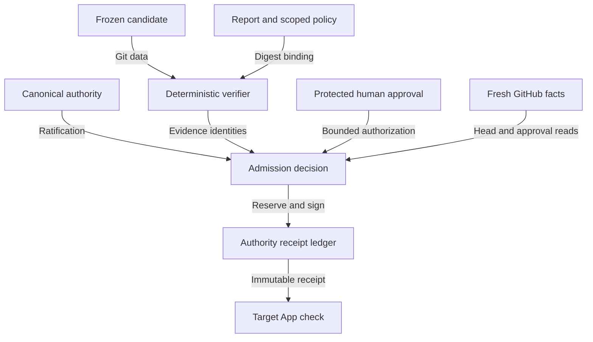

## Executive summary

The highest-impact failure would turn a stale or substituted research review into an authenticated authority check. The proposed route therefore binds one immutable candidate, independently recomputed evidence, an external report, disclosed independence limitations, canonical authority ratification and a protected human approval. All findings below concern proposed code, not an active admission service. Credential compromise and dishonest trusted human approval remain outside what deterministic evidence checks can eliminate.

## Scope and assumptions

In scope: `research_admission.py`, `research_admission_github.py`, the new workflow, strict schemas, scoped root/policy, receipt ledger and CLI adapter. Deployment is authority GitHub Actions using the existing App identity. There is no new network listener, model invocation or workstation service. Target files are data; no target execution under credentials is permitted. Synthetic test keys and API transports never establish actual admission.

The work order supplies the service owner, deployment, trust model and prohibited actions and instructs execution without optional questions. Those supplied constraints take precedence over a generic threat-model clarification pause. Assumptions: GitHub TLS/API account metadata and the approved Actions execution environment are trusted; the fixed trusted starter controls their account; App secrets stay in authority Actions. Open blockers are canonical ratification, explicit authorization, a protected approval environment, and target branch-protection visibility. Account compromise would increase the residual risk substantially.

## System model

### Primary components

The CLI dispatches to the new Actions adapter, which loads a strict scoped policy, verifies the canonical authority context, reads candidate Git objects, calls the existing deterministic prior verifier, and obtains fresh GitHub facts. A protected human review supplies risk authorization. The adapter reserves custody in an authority Git ledger, signs a receipt with the actual App key, then publishes and reads back a distinct check. Evidence anchors: `cli.py:_research_admission_run`, `research_admission.py:reconcile_candidate/decide`, `research_admission_github.py:run_actions_phase/publish_admission`.

### Data flows and trust boundaries

- Candidate repository → deterministic verifier: frozen Git objects over authenticated HTTPS/read-only checkout; exact repository/PR/base/head/tree/digest, clean tree, allowlist and packet checks. No candidate imports, scripts or Wolfram.
- Report/policy repository → authority runtime: Git object/file bytes; fixed predecessor, SHA-256, full accepted-tree equality and strict JSON schemas. Historical review is retained, never relabeled Local Review.
- GitHub API → authority decision: TLS, fixed host, authenticated reads, no redirects, fixed scope and bounded pagination. API actor metadata replaces caller identity assertions. Malformed/unknown errors reject.
- Human account → protected Actions job: GitHub environment approval history and strict JSON comment; fixed User ID/login, request/policy/evidence digests, expiry and complete limitations. Dispatch alone is insufficient.
- Authority runtime → App key/target API: authority Actions secret only; scoped installation token, actual App ID, target-only repository permissions. Errors omit credentials. Sessions are revoked on completion/failure where confirmed.
- Authority runtime → custody/check: authority Git Data API with non-forced CAS, signed immutable receipt, separate target App check, stale-head checks immediately before success and readback. Partial writes cannot silently retry.

#### Diagram

## Assets and security objectives

| Asset | Why it matters | Security objective |
|---|---|---|
| App private key and installation tokens | Can authenticate checks and governance records | C/I |
| Canonical authority policy and principal registry | Define who may authorize which candidate | I |
| Candidate/report/packet identities | Prevent false review attribution and stale acceptance | I |
| Human authorization and disclosed limitations | Preserve bounded, auditable risk acceptance | I |
| Receipt ledger and check state | Prevent conflicting admissions and ambiguous retries | I/A |
| Scientific history and CI records | Preserve honest claims and negative evidence | I |

## Attacker model

### Capabilities

A candidate contributor can propose changed source/evidence and move a branch; a requester can submit misleading IDs, JSON, reports or actor claims; concurrent callers can race admission or interrupt publication. A malicious reviewed report may omit limitations. A holder of an unrelated token may attempt foreign repository substitution. These inputs are untrusted until independently reconciled.

### Non-capabilities

An ordinary requester cannot rewrite canonical authority code, mint the fixed user's approval, read the Actions App secret, or force-update the authority ledger through this adapter. A compromised GitHub administrator, trusted-starter account, runner or App key is a different trust failure. The route provides no physical-presence, OS-isolated reviewer or institutional-signature guarantee.

## Entry points and attack surfaces

| Surface | How reached | Trust boundary | Notes | Evidence |
|---|---|---|---|---|
| Workflow dispatch IDs | Authenticated GitHub UI/API | Requester → authority | Dispatch does not approve | new workflow; `_run_actions_phase` |
| Candidate objects and packet | Target HTTPS fetch | Producer → verifier | Fixed exact case, complete diff/blob binding | `reconcile_candidate`, `verify_packet` |
| Report and root/policy JSON | Authority Git/files | Evidence → authority | Duplicate/nonfinite/unknown JSON rejected | `strict_json`, `load_contract` |
| Ratification/security comments | Authenticated issue API | Human/report publisher → authority | Exact unedited comments and accepted tree | `verify_ratification` |
| Environment approval | Authenticated review-history API | Human → admission | Actual configured reviewer, expiry, overlap | `verify_authorization` |
| Job annotations | Authenticated target Actions API | Infrastructure → CI assessment | Zero steps and exact startup cause | `assess_ci` |
| Receipt/check writes | Git Data/Checks APIs | Decision → external side effect | CAS, distinct name, signature, readback | `AuthorityLedger`, `publish_admission` |

## Top abuse paths

1. Move HEAD/base after review → reuse accepting report → obtain stale check. Exact identities and repeated PR reads reject.
2. Substitute R1/foreign report or omit limitations → claim acceptable provenance. Fixed report bytes and full limitations set reject.
3. Promote generated artifacts or omit paths → hide executable changes. Independent Git inventory, classification/blob checks and exact full-diff bytes reject.
4. Spoof an approver or dispatch without human review → authenticate unauthorized admission. Fixed numeric principal, merged ratification and actual protected review reject.
5. Describe a shared-provider review as isolated, or publish a local-review check → overstate assurance. Closed policy/schema and reserved check names reject.
6. Relabel executed failing tests as infrastructure unavailability → conceal regression. Exact run/job annotations, empty steps and matched JUnit baseline reject.
7. Race or interrupt receipt/check publication → create conflicting successes. CAS reservation, immutable signed custody, conflict/partial states and reconciliation prevent blind retry.
8. Leak an App token through redirects, errors or candidate execution → gain check authority. Fixed API host, no redirects, sanitized errors, target-only scope and data-only candidate use reduce exposure.

## Threat model table

| Threat ID | Threat source | Prerequisites | Threat action | Impact | Impacted assets | Existing controls (evidence) | Gaps | Recommended mitigations | Detection ideas | Likelihood | Impact severity | Priority |
|---|---|---|---|---|---|---|---|---|---|---|---|---|
| TM-001 | Contributor/requester | Can move target or supply references | Reuse review for another identity | False exact-head authority | Candidate/check integrity | `verify_pr`, `reconcile_candidate`, fresh pre/post reads; T01–06,T20–21 | GitHub has no atomic head-check publication primitive | Retain pre/post observations and partial reconciliation | Alert on head movement/partial check | medium | high | high |
| TM-002 | Evidence supplier | Can propose report/packet changes | Hide changes or upgrade independence | Misleading acceptance | Review/evidence integrity | Fixed hashes, `verify_packet`, typed limitations; T07–12,T28 | Shared provider/filesystem and unsigned reviewer verdict | Require explicit human acceptance; do not generalize enrollment | Audit report/packet digests | medium | high | high |
| TM-003 | Requester/compromised account | Attempts privileged workflow | Forge authorization or ratifier | Unauthorized admission | Authority policy/approval | `verify_ratification`, `verify_authorization`; T14–15,T22,T25–27 | GitHub account custody does not prove human presence; starter/producer account overlaps | Configure protected environment; protect account and canonical main | Audit actual approver and unedited comment IDs | medium | high | high |
| TM-004 | CI evidence supplier | Can request exception | Reclassify failed executed tests | Concealed regression | CI/scientific claims | `assess_ci`, `verify_compensating`; T18–19 | Hosted CI remains unavailable; historical local lint has bounded scope | Explicit compensating-control approval; resolve hosted CI separately | Alert on any executed step or new failure | medium | high | high |
| TM-005 | Concurrent requester/network fault | Can duplicate/interrupt publication | Conflict receipt/check or reuse partial state | Ambiguous or duplicate authority | Ledger/check custody | Non-forced CAS, signatures, readback, partial states; T23 | Cross-system transaction is not atomic | Reconcile partial ledger/check before new attempt; no blind retry | Monitor reserved/partial entries and cancellation uncertainty | medium | medium | medium |
| TM-006 | Runner/key attacker | Requires privileged environment compromise | Extract key or redirect tokens | Forged checks/signatures | Credentials | Authority-only secret, scoped token, pinned wheels, no candidate execution; T16–17 | Approved runner and GitHub/PyPI availability remain trusted | Keep secrets protected; rotate only through separate authorized incident process | Audit token/check issuer and key fingerprint | low | high | high |
| TM-007 | Policy author/requester | Can propose malformed policy/version | Activate unknown route or schema bypass | Expanded authority | Root/schema/history | Closed schemas, exact predecessor/case, full accepted tree; T13,T24–26 | Historical target V1 schema mismatch persists explicitly | Review V2 migration separately; preserve old bytes | Formal validation and byte-preservation receipts | medium | high | high |

## Criticality calibration

Critical means broad authority compromise: stolen App signing key or a canonical workflow publishing arbitrary successful checks. High means false acceptance for this target: forged human authorization, stale-head admission or concealed executable changes. Medium means bounded custody/availability damage: a reserved ledger requiring reconciliation or an unconfirmed cancellation. Low means informational presentation defects without authority changes: a stale explanatory link or redundant diagnostics. A model verdict or test suite alone never reduces authority risk to low.

## Focus paths for security review

| Path | Why it matters | Related Threat IDs |
|---|---|---|
| `src/miskatonic_review_authority/research_admission.py` | Identity, report, packet, schema and human authorization checks | TM-001–004,007 |
| `src/miskatonic_review_authority/research_admission_github.py` | Credential use, API facts, signature, CAS and publication | TM-001,003,005,006 |
| `.github/workflows/admit-research-evidence.yml` | Canonical-only deployment and protected approval boundary | TM-003,006 |
| `roots/research-admission-authority-v1.json` | Proposed predecessor/implementation binding and revocation | TM-007 |
| `policy/research-admission/` | Exact single-use scope, fixed principal, pinned dependencies | TM-002–004,006,007 |
| `schemas/research-*.schema.json` | Closed request/policy/receipt/authorization versions | TM-007 |
| `tests/test_research_admission.py` | All T01–T28 failures, partial custody and preservation | all |

## Notes on use

This model covers discovered runtime/CLI/workflow entry points and every described trust boundary. CI/build dependency installation is distinguished from data-only scientific verification and synthetic tests. Context is supplied by the work order; unresolved operational prerequisites remain explicit blockers. The proposed policy cannot self-ratify or authorize target integration. Review the retained negative-control and regression receipts before accepting this design.
